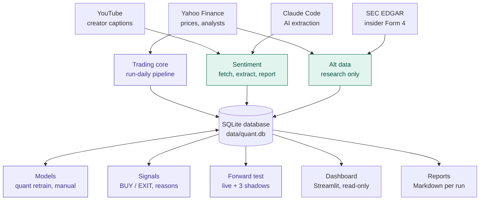
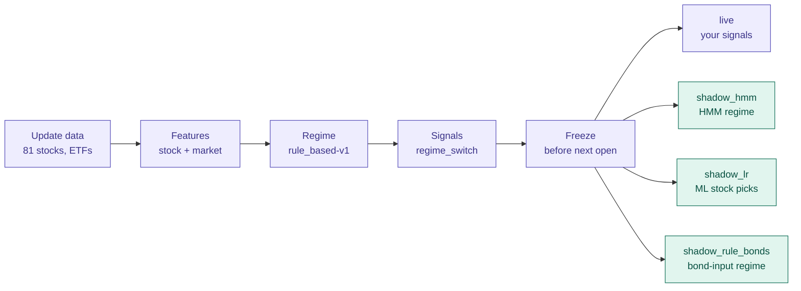
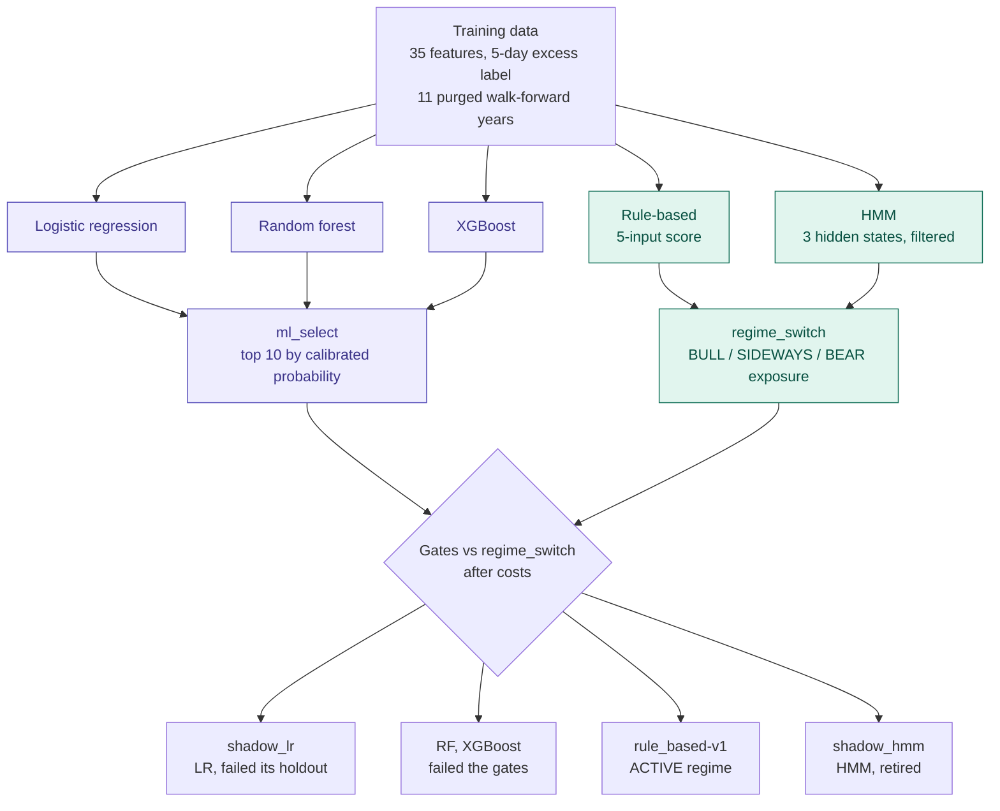

# Mini Quant Trader

A local quantitative trading research and signal-generation application for US equities.

## Overview

Mini Quant Trader is a personal research system designed to:
- Import market data from external APIs (currently Yahoo Finance)
- Store historical market data locally in SQLite
- Calculate technical and market features
- Detect market regimes (Bull, Sideways, Bear)
- Generate stock/ETF predictions using machine learning models
- Generate interpretable target exposures and BUY/HOLD/REDUCE signals
- Backtest strategies against explicit benchmarks
- Provide a Streamlit dashboard for monitoring

**Important**: This is a research and decision-support system. Model predictions are not reliable trading signals and should not be treated as recommendations to trade.

## Current Status

**Phase 10 - Forward testing** (Built: every evening the live strategy and two shadow strategies are frozen, paper portfolios trade them, your real account is replayed from a trade log, and `quant forward-report` and the dashboard score them all; the first look at the results is after 6 months). No ML predictor and no HMM regime passed its gates (Phases 5-7), so the signals come from the rule-based `regime_switch` strategy with the rule-based regime.

The project is currently in early development. Implemented features include:
- SQLite database with WAL mode for concurrent access
- Market data provider abstraction (YFinance)
- Incremental market data downloader
- Data validation and quarantine
- Corporate actions tracking
- CLI interface for data import and storage
- Split-adjusted OHLCV and dividend-aware total-return price series
- Versioned technical and market feature calculation
- Rule-based BULL/SIDEWAYS/BEAR market regime with hysteresis and minimum dwell time
- Rule-based trend, mean-reversion and regime-switch strategies with position and sector caps
- VectorBT backtests against SPY, equal weight and a random baseline, saved per run
- A filtered, walk-forward HMM market regime as a REGIME candidate (`quant retrain --role regime`)
- Logistic Regression, Random Forest and XGBoost predictors with purged walk-forward validation, calibration, pre-defined gates and a model registry (`quant retrain`)
- A signal engine: your positions file, the strategy's target weights at the latest close (identical to the backtest's), a risk layer, BUY / HOLD / REDUCE / EXIT with a hold band, suggested shares and a written reason per signal, stored in `signals` (`quant generate-signals`)

## Installation

### Prerequisites

- Python 3.10 or higher
- pip

### Setup

1. Clone the repository:
```bash
git clone <repository-url>
cd mini-quant-trader
```

2. Install dependencies:
```bash
pip install -e .
```

This will install the required packages:
- pandas >= 2.0
- numpy >= 1.24
- yfinance >= 0.2.54
- SQLAlchemy >= 2.0
- exchange-calendars >= 4.5
- PyYAML >= 6.0

## Usage

### Command Line Interface

The application provides a CLI for market data operations.

#### Daily Pipeline

Run every stage in one step:

```bash
python -m quant run-daily
```

This runs `update-market-data`, `calculate-features`, `calculate-regime`, `generate-signals` and `forward-test` in that order (they are described below). A stage that fails stops the run, because the next stage reads its output. Symbols that fail to download do not stop it: features, the regime and the signals are calculated from the stored data, and the command still exits with code 1. Every stage is safe to rerun. It accepts `--initial-date` and `--db` like `update-market-data`, and `--reasons` like `generate-signals`.

A typical day, after the US close (and before the next open, so the forward test can freeze the day):

1. Add any fills since the last run to `data/trades.csv` (see Forward Testing; before the forward test starts, update `data/positions.csv` instead).
2. Run `python -m quant run-daily --reasons`.
3. Read the signals. They are computed at the last close and meant for the next open; the suggested shares are estimates at that close.

#### Your Positions

The signals compare the strategy's target weights with what you hold. List your holdings in `data/positions.csv` (the path is `positions.path`; `data/` is git-ignored, so the file stays private):

```text
symbol,quantity,cost_basis
AAPL,10,175.20
MSFT,5,
CASH,25000,
```

- One row per stock you hold: the ticker as Yahoo writes it (e.g. `BRK-B`), the number of shares (fractions allowed) and, optionally, the cost per share (stored only).
- Exactly one `CASH` row; its quantity is your cash amount (`CASH,0,` if you hold none).
- Blank lines and lines starting with `#` are ignored; a quantity of 0 means not held.
- Errors stop the run with the file and line (a duplicate symbol, a negative quantity, a value that is not a number, no `CASH` row).
- A stock outside `market.symbols` is reported as not managed: no signal, and it is left out of the portfolio value the weights refer to.
- Without the file the portfolio is treated as all cash at `backtest.initial_cash`, so you still see what the strategy would buy.

Holdings are valued at the as-traded close of the signal session. Each run stores the file as that session's snapshot in the `positions` table.

Once the forward test has started, this file is **read only once, as its start**: your holdings then come from the start plus `data/trades.csv`, and the signals use those. Do not edit the file again (`status` warns if you do).

#### Generate Signals

After `calculate-regime` (or as the last stage of `run-daily`):

```bash
python -m quant generate-signals
python -m quant generate-signals --reasons
```

For the latest session T this runs `signals.strategy` (`regime_switch`) over the stored history, takes its target weights at T (the same weights the backtest uses), applies the risk layer (`risk`) and compares them with your positions:

| Current | Target | Signal |
|---|---|---|
| 0 | above 0 | BUY (new position) |
| above 0 | 0 | EXIT (sell all) |
| above 0 | at least `signals.hold_band` (2 points) higher | BUY (increase) |
| above 0 | at least 2 points lower | REDUCE |
| above 0 | within 2 points | HOLD |

Suggested shares round down to whole shares; a change below one share is flagged. A held stock without data at T is kept (HOLD) with a warning. The printout shows the regime, the portfolio value, the target invested share, a table (signal, target, current, shares, close, value), the counts and any warnings; `--reasons` adds one line per stock, e.g.:

```text
AAPL: Bull regime (rule_based-v1): trend rule. Trend: price +16% vs SMA200, SMA50 +11% vs SMA200; in the strategy for 124 sessions. Equal weight 1/29. Sector cap 30% binds (information technology). Volatility 16% within limit. ATR stop 323.15 (2 x ATR below 336.64). Target 2.7% vs current 19.8% -> REDUCE (sell 8 shares).
```

Reasons are stored either way. Signals go to the `signals` table (one row per stock with a signal; re-running a session replaces that session's rows), and each stage is logged in `pipeline_runs`. Without an ACTIVE predictor the prediction stages are skipped and logged. The rules are in sections 18.1 and 19.1 of `proposal.md`. This is research output, not advice.

#### Update the Configured Symbol Pool

Fetch missing daily bars for `market.symbols` and `market.market_symbols` (from `config/settings.yaml`) through the last completed NYSE session:

```powershell
python -m quant update-market-data
```

New symbols start from `market.initial_history` (2005-01-01 by default; override once with `--initial-date YYYY-MM-DD`); existing symbols only fetch sessions after their last stored bar. Edit `market.symbols` in `config/settings.yaml` to change the pool.

#### Calculate Features

After updating the configured symbol pool, calculate and persist features from the stored prices:

```bash
python -m quant calculate-features
```

This recomputes feature history (including adjustment changes from stored corporate actions) and updates the `features` and `market_features` tables in `data/quant.db`. Warm-up rows remain NULL. SPY data is required for relative returns and market features; QQQ and ^VIX provide their respective optional market indicators.

#### Calculate the Market Regime

After calculating features, classify every session as BULL, SIDEWAYS or BEAR:

```bash
python -m quant calculate-regime
```

The score at each session sums five -1/0/+1 inputs (SPY trend, QQQ trend, SPY SMA50 vs SMA200, SPY 3-month return, VIX level), and a state machine with hysteresis (`regime.enter_threshold` / `regime.exit_threshold`) and a minimum dwell time (`regime.min_dwell_days`) turns scores into regimes; the full rules are in section 12 of `proposal.md`. Sessions missing any input get no regime. The whole history is recomputed and replaces the stored rows of the `market_regimes` table for `rule_based-v<regime.version>`; bump `regime.version` when changing any `regime` setting.

#### Backtest the Strategies

After `run-daily`, compare the rule-based strategies with SPY buy-and-hold, an equal-weight portfolio of the pool and a random baseline:

```bash
python -m quant backtest
python -m quant backtest --strategy trend --strategy regime_switch
python -m quant backtest --evaluate-holdout
```

Orders are decided at the close and filled at the next open, with fees, slippage and a minimum trade size from the `backtest` settings; the strategies are described in section 17 of `proposal.md` and the engine in section 20.1. The report shows the development period. The holdout (the last `retrain.validation.holdout_months`) is shown only with `--evaluate-holdout`; every evaluation is logged in `pipeline_runs`, and the report says how many times the holdout has been viewed. Each run is saved as a batch in `backtest_runs` (metrics, costs, parameters, config hash, git commit) and `backtest_equity` (daily value), with holdout rows only when it was evaluated. A run takes about 40 seconds, mostly the random baseline.

#### Retrain a Predictor (manual)

Train and validate a machine-learning stock predictor, and register it as a candidate:

```bash
python -m quant retrain --role predictor --model logistic_regression
python -m quant retrain --role predictor --model random_forest
python -m quant retrain --role predictor --model xgboost
python -m quant retrain --role predictor --model all
python -m quant retrain --role predictor --model logistic_regression --evaluate-holdout
```

The market regime has its own candidate:

```bash
python -m quant retrain --role regime
```

It fits a 3-state hidden Markov model on daily SPY returns, market volatility and VIX (`regime.hmm`) once a year on the same walk-forward folds, uses filtered (point-in-time) probabilities only, trades `regime_switch` with it and with the rule-based regime, evaluates `retrain.gates.regime`, and registers the final fit as a REGIME candidate (about a minute). The report embeds a regime timeline chart (`<model_id>_regimes.svg`, with an interactive `<model_id>_regimes.html` next to it): SPY on a log scale above the HMM and rule-based regimes from 2005, with the HMM's in-sample years (before its first out-of-sample session) drawn faded. The rule-based regime stays in use unless a candidate is promoted.

This builds the dataset (label: stock vs SPY over the next `model.target.horizon_days` sessions, section 14 of `proposal.md`), searches the hyperparameters in `retrain.search.space` on purged walk-forward folds, backtests the best candidate walk-forward as `ml_select` against `regime_switch` after costs, evaluates the gates in `retrain.gates.predictor`, refits the model on all development data and registers it as a CANDIDATE in `model_versions`. The model file goes to `retrain.models_dir` and a readable validation report to `retrain.reports_dir`, one folder per model type like the model files (`reports/<model_type>/<model_id>.md`; both git-ignored). It never changes an active model, and the holdout is used only with `--evaluate-holdout` (logged; the count is shared with `backtest`). Logistic Regression takes about 20 seconds, Random Forest about 3 minutes, XGBoost longer (30 random search trials). `--model all` retrains the three in turn (each registered with its own report, exactly as one by one) and then prints one comparison table on the same walk-forward window: CAGR, Sharpe, max drawdown, turnover, years beating `regime_switch`, AUC, calibration error and gates, with `regime_switch`, SPY and equal weight; the table is also saved to `reports/comparison/`. It never uses the holdout (`--evaluate-holdout` is refused with `all`).

#### Status and Promotion

```bash
python -m quant status
python -m quant promote <model_id>
python -m quant promote <model_id> --override "reason"
python -m quant retire <model_id> --reason "why"
```

`status` is read-only: data freshness against the last completed NYSE session, the last successful run of every stage, the ACTIVE model per role, which strategy and regime the signals use, and warnings (stale data, failed runs, quarantined rows, a positions file edited after the last signals, an ACTIVE model whose outputs are behind). `promote` makes a candidate the ACTIVE model of its role and retires the previous one; a candidate whose gates failed is refused unless `--override` gives a reason, which is logged. `retire` sets the ACTIVE model of a role to RETIRED, so that role falls back to its rule-based version (the rule-based regime, or rule-based signals); `promote` it again to undo. Both are logged.

With an ACTIVE HMM, `calculate-regime` also stores its filtered regime and the signals use it. With an ACTIVE predictor, `generate-signals` first stores its predictions (table `predictions`, with a hash of the inputs) and `ml_select` drives the signals: the top `strategies.ml_select.top_n` stocks by probability, the regime setting the exposure, the same risk caps and hold band. Today no model has passed its gates, so the rule-based path is what runs.

#### Dashboard

```bash
streamlit run dashboard/app.py
```

A read-only view of the database in the browser (it never writes or triggers anything; the CLI does). Pages: **Status** (what `quant status` shows), **Market** (regime, SPY / QQQ / VIX, SPY with the regime ribbon), **Signals** (today's signals with reasons, and the positions snapshot), **Sentiment** (creator opinions per day: market mood, stock tables, summaries, quotes with video links), **Forward test** (each run: scores, growth and drawdown curves, followed share, execution costs, the latest frozen targets), **Stock detail** (price with SMA50 / SMA200, RSI, MACD, volume, and creator opinions marked on the price), **Models** (candidates, gates, validation reports) and **Backtest** (metrics, equity and drawdown per saved batch). Refresh the page after `run-daily`. Another settings file or database: `streamlit run dashboard/app.py -- --config path/to/settings.yaml --db path/to/quant.db`.

#### Forward Testing

The only clean evidence left is what happens from now on. Every evening the system freezes what each strategy wanted at that close, and later scores it against what actually happened. The rules were fixed before any forward data (Phase 10 in section 29 of `proposal.md`).

| Portfolio | What it is |
|---|---|
| `live` | `regime_switch` with the regime in use: the signals you see |
| `shadow_hmm` | `regime_switch` with the retired HMM regime (never traded) |
| `shadow_lr` | `ml_select` with the logistic regression candidate (never traded) |
| `real` | your account: `positions.csv` at the start plus `trades.csv` |
| `SPY` | buy-and-hold from the start |

Shadows are set in `forward_test.shadows`. Paper portfolios start with your account's value in cash and trade their frozen targets at the next open with the backtest's costs.

**Start, once,** on an evening after the close and before the next open, with your real account in `data/positions.csv`:

```bash
python -m quant forward-test --start
```

It prints the start date and value (check it against your account). From then on `run-daily` freezes every evening. A session is frozen only before the next market open (a whole evening and night, or a weekend); a session you miss is counted as missed and never added later. Paper portfolios keep their last targets over a missed day.

**Record every fill** in `data/trades.csv` (`positions.trades_path`), one line per fill:

```text
date,symbol,side,quantity,price,fees,amount
2026-10-13,BRK-B,SELL,9,514.80,0.50,
2026-10-13,AMZN,BUY,2,263.10,,
2026-11-02,AAPL,DIVIDEND,,,,2.60
```

- `BUY` / `SELL`: shares and the fill price per share; `fees` (total) optional.
- `DIVIDEND`: `amount` of cash received; it counts as return. Deposits and withdrawals are not tracked: avoid them during a run, or they show up as return.
- Cash follows from the trades. A forgotten trade can be added later with its real date; frozen targets never change.
- Refused with the line number: a trade on or before the start, after the latest stored session, or selling more than you hold. Negative cash is a warning.

**Read the results:**

```bash
python -m quant forward-report
```

Return, volatility, Sharpe, max drawdown and missed sessions per portfolio; the **followed share** (how much of the live targets you held, compared with the previous evening's target) and your **execution cost** against the open (next to the backtest's 6 bp). It is read-only. Before about 126 forward sessions (6 months) the numbers are mostly noise, and the pre-registration rules out any decision on them before then; a verdict comes at 12 months.

**Restart** only for a wrong start, a changed setup or a long gap, never because results look bad:

```bash
python -m quant forward-test --end --reason "started with the wrong positions"
```

The run is kept, with its end date and reason, and the report lists it (`quant forward-report --run 1`). Then put the account in `positions.csv` and `--start` again after a close; only trades after the new start count. `quant status` shows the run, frozen and missed sessions, and warns when tonight's session is not frozen yet or the trade log has an error. The dashboard's Forward test page shows the same, with the curves.

#### Creator Opinions (research, `sentiment_proposal.md`)

Collects what a few finance YouTube creators say about single stocks. It is research only: not part of `run-daily`, and nothing from it reaches the signals. Its packages (yt-dlp, youtube-transcript-api, opencc) come with the normal `pip install -e .`.

Step 1 (S1) lists new videos of the channels in `sentiment.channels` and stores their captions:

```bash
python -m quant sentiment fetch
python -m quant sentiment fetch --channel @chipstockinvestor --days 30
```

It prints each step as it goes (also in the log). Members-only videos, Shorts and live replays are recorded as skipped. Re-runs only fetch what is missing; failed captions are retried on the next run, and a video without captions is asked again for 3 days (`sentiment.no_captions_retry_days`), because captions often appear hours after a video is published. To avoid being blocked by YouTube, each request waits 8-15 s (`sentiment.request_delay_seconds`) and a run fetches at most 10 captions, oldest first (`sentiment.max_captions_per_run`); the rest waits for the next run. If YouTube blocks the requests anyway, the run stops and the rest waits for a later run (often a few hours). Opinion extraction, summaries and the scorecard come in later steps (section 12 of the proposal).

The **gold set** is the hand-labeled answer key that extraction is scored against (section 4.6 of the proposal):

```bash
python -m quant sentiment gold-export
```

The first run picks `sentiment.gold.videos` (10) videos with stored captions, channels taking turns, and writes `videos.csv`, an empty `opinions.csv` and the rules in `LABELING.md` to `sentiment.gold.labels_dir` (committed: they hold no transcript text), plus readable transcripts in `data/sentiment_gold/transcripts/` (git-ignored; delete them any time). Label every video, then set its `status` to `done` or `done-none`. Later runs never touch the label files; they only write the transcripts again, and `--add N` appends N more videos. The current set in `research/sentiment_ai_reference/` (20 videos) was labeled with an AI tool (GPT or MAI), so it is an **AI reference**: scores against it measure agreement, not accuracy (see its `SOURCE.md`).

Step 2 (S2) extracts opinions from the stored transcripts with `sentiment.extraction.backend`; `claude_code` runs Claude Code (`claude -p`) on your Pro subscription, so it needs no API key, but `ANTHROPIC_API_KEY` must not be set:

```bash
python -m quant sentiment extract --limit 5
python -m quant sentiment extract --video khnPevsQ_TE --model haiku
```

It prints the number of calls and an estimate of the tokens first; more than `max_videos_per_run` videos need `--yes`. Each opinion has a ticker, stance, horizon, conviction, the creator's own action, a verbatim quote and its time. A quote that does not match the transcript makes the opinion UNVERIFIED, and a ticker that is neither in `config/sentiment_aliases.yaml` nor listed on a US exchange makes it UNRESOLVED; the run lists unresolved names so you can add them to the alias table. Every video is extracted once per backend, model and prompt version (`--reextract` does it again); a usage limit stops the run cleanly. Results are in the `sentiment_opinions` table; reports come with S3.

Step 3 (S3) writes the **daily reports** you read, one per trading day, in `reports/sentiment/<date>.md`:

```bash
python -m quant sentiment summarize
python -m quant sentiment report
```

`summarize` writes a short summary per stock and day with `sentiment.summary` (Haiku by default; one call per day), from verified opinions only, and summarizes a day again when its opinions change. `report` writes, per day: the market mood; a table per stock and ETF with bulls, bears, conditional and neutral creators, the net count and who said what (★ marks stocks in your pool); the summaries; every quote with a link to the second in the video; and what was not counted (unmatched quotes, unresolved names). Research only: an opinion is not a signal.

Every opinion on one stock over time, newest day last, with the day's summary, each quote and a link to the second in the video (read-only; a ticker or a name from the alias table):

```bash
python -m quant sentiment stock NVDA
python -m quant sentiment stock 美光 --from 2026-10-01
```

`--all` also shows opinions whose quote did not match the transcript.

Everything in one go, e.g. once a day (it is never part of `run-daily`):

```bash
python -m quant sentiment run
```

It runs `fetch`, `extract`, `summarize` and `report`; each step runs even when an earlier one had problems (e.g. YouTube blocking the fetch). `--days` and `--channel` go to the fetch, `--limit`, `--model` and `--yes` to the extract.

To review the extraction against the labeled videos (the S2 quality gate):

```bash
python -m quant sentiment review-export
```

It prints the agreement with the labels and writes every disagreement (only in the labels, only from the extractor, or a different direction) with the quote, a link to the second in the video and the transcript lines around it to `data/sentiment_gold/reviews/review-<backend>-<model>-v<prompt>.csv`. Fill in `verdict` (`reference`, `extractor`, `both` or `neither`) and optionally `comment`; the file is never overwritten.

#### Insider Transactions (research, `altdata_proposal.md`)

SEC Form 4 filings for the stock pool: who among a company's officers, directors and 10% owners bought or sold its stock, when, how much and at what price. Research only: not part of `run-daily`, and no feature uses it until the pre-registered research of the proposal (section 8) is done.

```bash
python -m quant altdata update
python -m quant altdata coverage
```

The first `update` is a backfill from 2006: one quarterly SEC data set at a time (about 1.2 GB of downloads in total; only the pool's rows are kept), then the filings since the newest quarter, one by one from EDGAR. Later runs only fetch what is new. Every request sends `altdata.user_agent` (the SEC requires a name and an email) and stays at `altdata.sec.max_requests_per_second` (5; the SEC allows 10). A filing from the quarterly data sets counts from the session after its filing date (they have no time of day); a filing fetched live from the first session closing after it was accepted. Bad lines (no price, a price far from that day's close, a trade dated after its filing) go to `data_quarantine`. `coverage` writes `reports/altdata/coverage-form4.md`: filings and purchase / sale lines per stock and year.

#### Logs

Every command logs to `data/logs/quant.log` (next to the database; rotated by `logging.max_megabytes` and `logging.backups`): start and finish with exit code and duration, crashes with the traceback, every error shown in the terminal, every pipeline stage, download failures, quarantined rows and signal warnings.

Every command accepts `--db PATH` to use another SQLite file instead of `database.url` from `config/settings.yaml`.

### Configuration

All settings live in one file, `config/settings.yaml`, laid out as in section 27 of `proposal.md`: database, market (provider, symbols, calendar, initial history), features, regime, strategies, model, retrain, backtest, risk, positions and signals. Use another file with `python -m quant --config path\to\settings.yaml <command>`. Every section and key is required, and unknown or invalid settings are rejected at startup; there are no defaults in code, so the file is the only place a value is defined. `market.symbols` maps each GICS sector to its stocks (e.g. `energy: [XOM, CVX, SLB]`); sectors feed the sector cap `risk.max_sector_weight`, and `update-market-data` writes them into the `symbols` table. The `strategies` and `risk` sections drive the rule-based strategies (section 17 of `proposal.md`) and the signal engine: `risk.max_position_size`, `risk.max_sector_weight` and `risk.max_portfolio_exposure` change weights (in the backtest too), while `risk.atr_stop_multiple` and `risk.high_volatility` only add an ATR stop price and a volatility flag to the reasons. `signals.strategy` picks the rule-based strategy that drives the signals and `signals.hold_band` the HOLD band; a band different from `backtest.min_trade_weight` gives a warning, because live signals would then not trade like the backtest.

`features.sma` must match the `price_vs_sma<N>` columns of the `features` table (checked when features are calculated), because those columns are named after the windows. Other indicator parameters (MACD 12/26/9, return and volatility windows) are part of the feature definition, so changing them means bumping `features.version`.

### Database

The application uses SQLite with WAL mode for local data storage. The database file is set by `database.url` (default `data/quant.db`).

`daily_prices` holds prices, volumes and dividends as originally traded. Yahoo returns them rescaled for later splits, and `YFinanceProvider` reverses that (see section 8 of `proposal.md`). Databases built before this fix hold Yahoo's split-rescaled values, and stored rows are never overwritten, so rebuild such a database: move `data/quant.db` aside, then run `python -m quant update-market-data` and `python -m quant calculate-features`.

## Project Structure

```
mini-quant-trader/
  config/settings.yaml   all settings (proposal section 27)
  data/                  quant.db, positions.csv, trades.csv, logs/ (git-ignored)
  quant/
    cli.py               the commands
    data/                provider, calendar, ingestion, quality checks
    features/            technical and market features
    regime/              rule-based regime, HMM candidate, regime report and chart
    strategies/          rule-based strategies and sizing
    backtest/            VectorBT backtests, metrics, reports
    models/              ML predictors, walk-forward validation, gates, registry
    signals/             positions, target weights, BUY/HOLD/REDUCE/EXIT, reasons, signal stages
    forward/             forward test: freeze, paper portfolios, real account, report
    ops/                 status, promote, retire
    dashboard/           data for the Streamlit app
    persistence/         tables and queries (SQLAlchemy Core)
    sentiment/           creator opinions: YouTube captions, extraction, summaries, reports (research only)
    altdata/             SEC Form 4 and analyst changes, A4 research (research only)
  dashboard/app.py       the Streamlit app
  models/, reports/      written by `retrain` and the research commands (git-ignored)
  tests/                 unittest suite
```

## Architecture

Three modules share one SQLite database. Only the trading core feeds your signals; sentiment and alt data are research and never change what is traded.



Each evening `run-daily` runs the trading core in order. The freeze writes tonight's targets for every portfolio into the forward-test log before the next market open; frozen sessions are never changed or backfilled.



Shadows are never traded: they are recorded so that, after 12 months, each can be compared with `live` under the rule fixed before the forward test began (`proposal.md`, Phase 10).

### Models

The models have two roles. A **predictor** decides *which* stocks to hold: it gives each stock a calibrated probability of beating SPY over the next 5 sessions, and `ml_select` holds the 10 most likely. A **regime** decides *how much* is invested: `regime_switch` follows the trend in BULL, trades dips in SIDEWAYS and goes to cash in BEAR.

`quant retrain` (manual, never part of `run-daily`) fits the candidates on purged walk-forward folds and backtests them against `regime_switch` after costs. It registers a candidate only through pre-defined gates; `quant promote` is a separate, manual step.



Where it stands:
- No predictor is ACTIVE, so the stocks come from the rule-based selection inside `regime_switch`.
- The rule-based regime `rule_based-v1` is ACTIVE.
- The HMM regime was promoted and later retired after its holdout check.
- The logistic regression and the HMM run on as forward-test shadows. A rule-based variant with bond-market inputs (`rule_bonds-v1`) runs as a third shadow.
- The full trial record is in `proposal.md` (sections 13 and 15.4).

## Architecture Principles

- **Python-first**: The complete system uses Python
- **SQLite as a local file**: Sufficient for single-user, local, daily data
- **Raw data is the source of truth**: Derived features are computed from raw data
- **Incremental data ingestion**: Only downloads missing data, not full history
- **Time and execution convention**: Signals at T execute at T+1 open

## Planned Features

See [quant_app_developer_proposal_final.md](proposal.md) for the complete design specification.

Later work:
- The 6-month first look and the 12-month verdict of the forward test
- Drawdown protection on the real account (its value history now exists in the forward test)
- Automatic daily runs (e.g. a scheduled task), if wanted
- Paper trading through a broker API only after the forward test; no live trading in V1

## Development

### Running Tests

```bash
python -m unittest discover -s tests
```

### Code Style

The project follows standard Python conventions. Contributions should maintain the existing code structure and style.

## Data Provider

The current implementation uses `yfinance` as the market data provider. This is an unofficial scraper that can break, rate-limit, and revise data. The provider is isolated behind an abstraction interface to allow future replacement with professional data sources (Polygon, Tiingo, IBKR, etc.).

## License

[Specify your license here]

## Contributing

[Specify contribution guidelines here]
